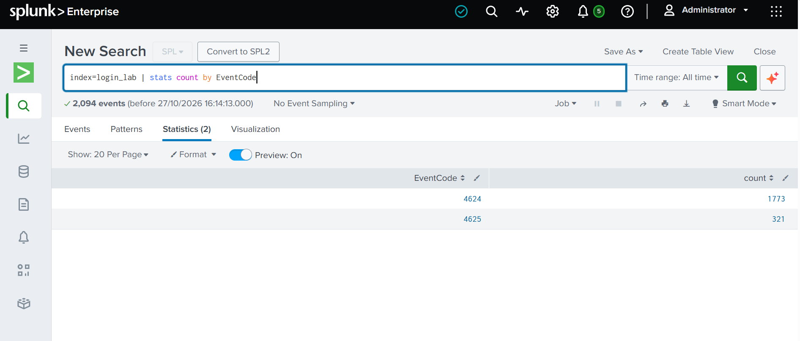
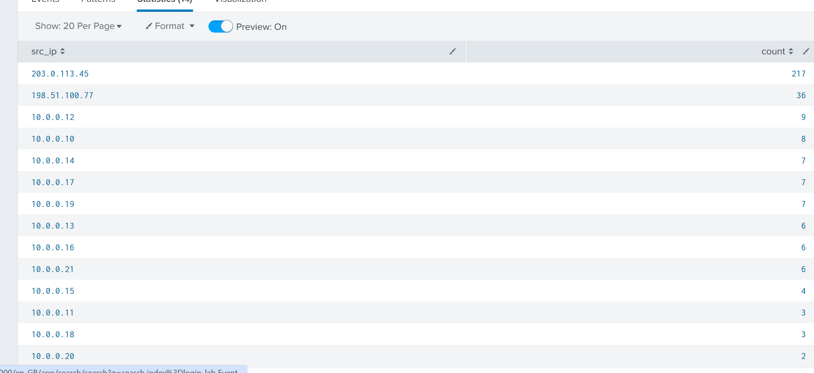
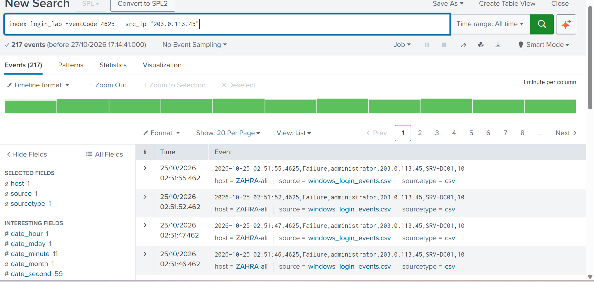
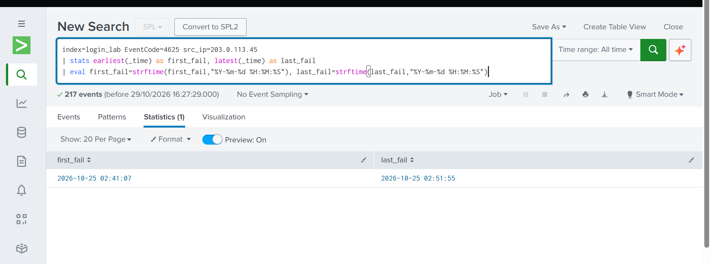
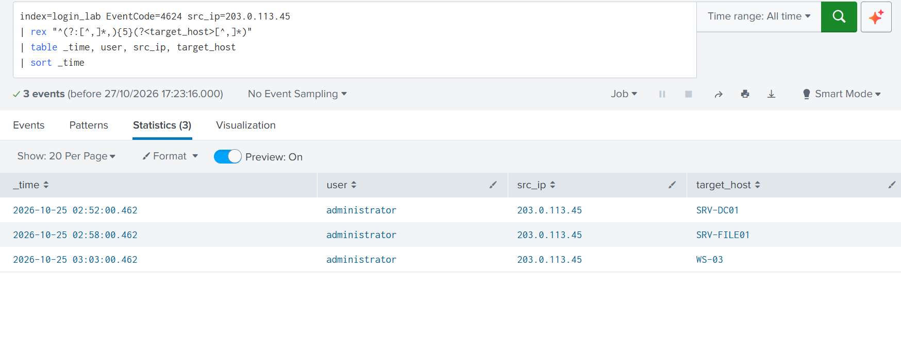
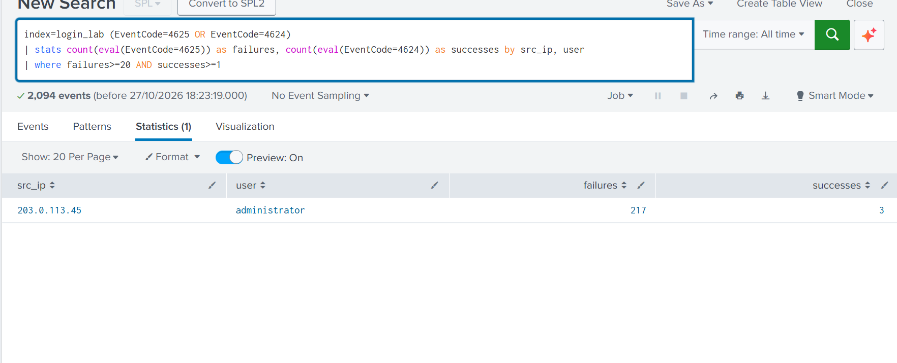
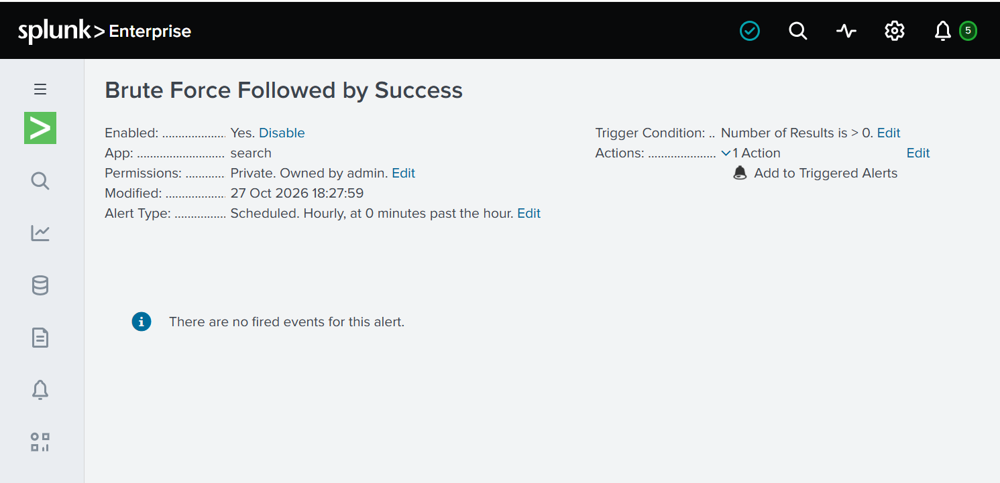
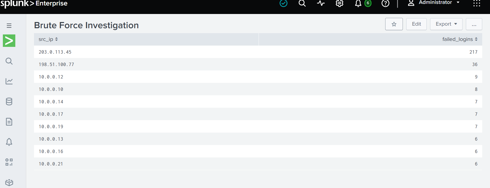
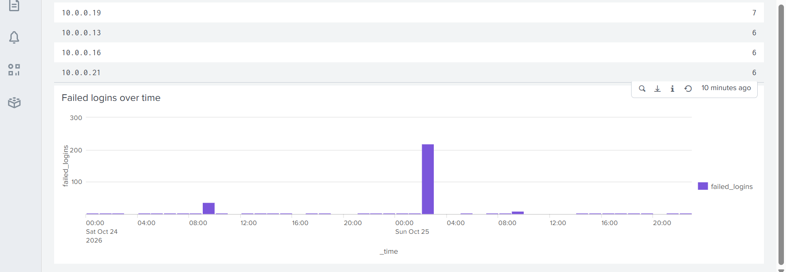

# Splunk Brute Force Investigation

A SOC Level 1 practice project: finding a brute force attack that ended in a compromised account, using Splunk.

> **Note:** The dataset is **simulated** (about 2,000 Windows login events, made for practice). The IP addresses come from documentation ranges. This is not real company data.

## Interview Summary

- **What:** Investigated a brute force attack in Windows login logs using Splunk.
- **Data:** 2,094 simulated events (1,773 successful logins, 321 failed logins).
- **Found:** One IP made 217 failed logins on the `administrator` account, then logged in 5 seconds later and moved to 2 more machines within 11 minutes.
- **Built:** A detection search, a saved hourly alert, and a dashboard.
- **Mapped to MITRE ATT&CK:** T1110 (Brute Force), T1078 (Valid Accounts), T1021 (Remote Services).

## Tools and Skills

Splunk Enterprise, SPL (stats, eval, rex, timechart), log analysis, alert tuning, MITRE ATT&CK mapping, incident reporting.

## Key Findings

| Finding | Detail |
|---|---|
| Attacker IP | `203.0.113.45` |
| Target account | `administrator` on `SRV-DC01` |
| Failed logins | 217 (02:41:07 to 02:51:55 on 25 Oct 2026) |
| Successful login | 02:52:00, only 5 seconds after the last failure |
| Lateral movement | `SRV-FILE01` at 02:58, `WS-03` at 03:03 |
| Verdict | True positive, high severity |

Other activity I checked:
- `198.51.100.77` tried 36 logins across 12 users with no success. This looks like **password spraying**.
- `hira.khan` had 8 failures, then a success. This is a **false positive** (a forgotten password).

## How I Investigated

**1. Load the data and check it.**
```
index=login_lab | stats count by EventCode
```


**2. Find the top IPs by failed logins.**
```
index=login_lab EventCode=4625
| stats count as failed_logins by src_ip
| sort - failed_logins
| head 10
```


**3. Look at the attacker's failed events.**


**4. Check the exact start and end time of the attack.**
```
index=login_lab EventCode=4625 src_ip=203.0.113.45
| stats earliest(_time) as first_fail, latest(_time) as last_fail
| eval first_fail=strftime(first_fail,"%Y-%m-%d %H:%M:%S"), last_fail=strftime(last_fail,"%Y-%m-%d %H:%M:%S")
```


**5. Check if the attacker got in, and where they went next.**
```
index=login_lab EventCode=4624 src_ip=203.0.113.45
| rex "^(?:[^,]*,){5}(?<target_host>[^,]*)"
| table _time, user, src_ip, target_host
| sort _time
```
I used `rex` to pull the real target host from the raw event, because Splunk's default `host` field shows the machine that loaded the file.



## Detection

This search finds a source IP and user with many failures followed by a success:

```
index=login_lab (EventCode=4625 OR EventCode=4624)
| stats count(eval(EventCode=4625)) as failures, count(eval(EventCode=4624)) as successes by src_ip, user
| where failures>=20 AND successes>=1
```

**Why the threshold is 20:** the false positive (8 failures) stays below it, and the real attack (217) is far above it. The search returns exactly one result: the attacker.



I saved it as an alert named **Brute Force Followed by Success**, scheduled hourly, triggering when results are greater than 0.



## Dashboard

The dashboard has two panels: the top IPs by failed logins, and failed logins over time. The chart shows two spikes: the spraying on 24 Oct around 09:00, and the brute force on 25 Oct around 02:00.




## Full Report

For the full timeline, analysis, MITRE mapping, and recommended actions, see [incident_report.md](incident_report.md).

## Limits and Next Steps

- The data is simulated. Next, I want to repeat the same searches on a real public dataset.
- The detection does not catch password spraying. I would add a second rule that counts failures across many users from one IP.
- The alert searches all time. In real use, I would limit it to the last 15-60 minutes.

## How to Repeat This

1. Install Splunk Enterprise (free trial).
2. Create an index called `login_lab`.
3. Upload `windows_login_events.csv` (Settings, Add Data, Upload).
4. Run the searches above with the time range set to **All time**.
